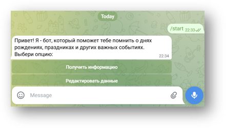
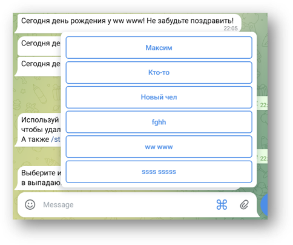

# 🤖 Телеграм-бот «Birthday Reminder»

Учебный проект по разработке Telegram-бота на Python, который помогает пользователям помнить о днях рождения и важных событиях.

## 📋 Функционал бота

*   **Управление записями:** Добавление, удаление и просмотр дней рождения с возможностью группировки (семья, друзья, коллеги) и добавления заметок.
*   **Быстрый просмотр:** Вывод полного списка всех сохранённых дат и фильтрация по текущему дню (кто празднует сегодня).
*   **Автоматические напоминания:** Ежедневная рассылка уведомлений в 9:00 утра для всех пользователей, у которых есть записи на текущую дату (реализовано через фоновый планировщик).
*   **Удобный интерфейс:** Пошаговый диалог при добавлении данных (`ConversationHandler`), использование интерактивных кнопок и всплывающего меню для выбора записи при удалении.

## 🛠 Технический стек
*   **Язык:** Python
*   **Библиотеки для работы с Telegram:** `python-telegram-bot` (обработка команд, `ConversationHandler` для диалогов, создание `InlineKeyboardMarkup` и `ReplyKeyboardMarkup`).
*   **База данных:** `SQLAlchemy` (ORM для работы с SQLite) — создание моделей, фильтрация и управление сессиями.
*   **Планировщик:** `schedule` + `threading` (запуск уведомлений в отдельном потоке, чтобы бот не зависал).
*   **Безопасность:** `os` / переменные окружения (токен не хранится в коде).

## 💡 Ключевые навыки, отработанные в проекте
*   **Разработка интерфейсов ботов:** Создание пошаговых сценариев общения с пользователем (диалогов) и интерактивных клавиатур.
*   **Проектирование баз данных:** Создание моделей данных, настройка сессий и написание запросов на фильтрацию (по датам и пользователям).
*   **Работа с фоновыми процессами:** Реализация планировщика задач в отдельном потоке для отправки автоматических уведомлений.
*   **Обеспечение безопасности:** Защита чувствительных данных (токенов) от попадания в репозиторий.
*   **Git:** Пошаговое сохранение проекта.

## 📂 Структура репозитория
*   `main.py` — запуск бота, обработка команд, `ConversationHandler` и логика планировщика.
*   `database.py` — работа с базой данных (модели SQLAlchemy, функции добавления/удаления/фильтрации).
*   `config.py` — получение токена и URL базы (через переменные окружения).
*   `utils.py` — вспомогательные методы (создание клавиатуры).
*   `birthdays.db` — файл базы данных SQLite.
*   `screenshots/` — скриншоты для документации.
*   `requirements.txt` — зависимости.
*   `README.md` — описание проекта.

## 📚 Документация
*   📊 **[Презентация проекта (PDF)](./Презентация%20бот%20.pdf)** — визуальное описание архитектуры и этапов разработки.

 
